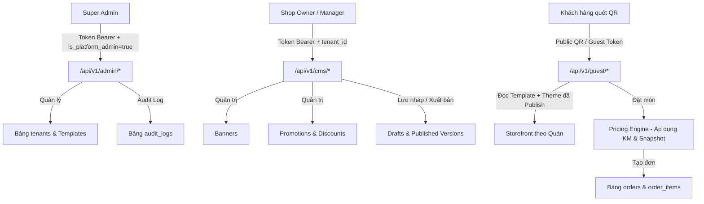

# BÁO CÁO KIỂM KÊ VÀ ĐÁNH GIÁ HIỆN TRẠNG HỆ THỐNG
**Hệ thống:** QR Ordering PWA Multi-Tenant v1.2  
**Thời điểm thực hiện:** 19/10/2026  
**Mục tiêu:** Đánh giá cấu trúc hiện tại, xác định khoảng trống nghiệp vụ và chuẩn bị kiến trúc tích hợp Multi-Tenant CMS theo đặc tả `ANTIGRAVITY_MULTI_TENANT_CMS_SPEC.md`.

---

## 1. Tổng quan Kiến trúc & Tech Stack

- **Backend:** Node.js (v20+) + Express + TypeScript (`tsx`)
- **Database:** PostgreSQL 16 (chạy qua connection pool `pg`, có UUID extension `pgcrypto`, indexes)
- **Realtime:** Socket.IO v4 (phòng theo tenant: `tenant:{tenantId}`, session: `session:{sessionId}`)
- **Thông báo:** Web Push (Apple APNs / Google FCM qua `web-push` RFC 8292 VAPID)
- **Frontend:** React 18 + Vite 6 + Tailwind CSS v4 + Lucide Icons + React Context API
- **Kiến trúc dữ liệu:** Multi-tenant với shared database, bảng có cột `tenant_id` phân tách logic.

---

## 2. Kiểm kê Thực thể & Database Schema Hiện Tại

Hiện tại cơ sở dữ liệu `qr_order_db` gồm 20 bảng:
1. `tenants`: Định danh quán (`id`, `slug`, `name`, `currency`, `timezone`).
2. `users`: Tài khoản nhân viên/quản lý (`id`, `email`, `password_hash`, `full_name`, `is_platform_admin`).
3. `memberships`: Phân quyền nhân viên theo tenant (`tenant_id`, `user_id`, `role`, `permissions`, `is_active`).
4. `tables`: Bàn ăn vật lý (`tenant_id`, `table_number`, `public_qr_id`, `capacity`, `readiness`, `is_enabled`).
5. `table_sessions`: Phiên phục vụ (`tenant_id`, `table_id`, `status` [OPEN/CLOSED], `settlement_version`).
6. `guest_sessions`: Phiên truy cập của khách quét mã QR (`token_hash`, `expires_at`, `revoked_at`).
7. `menu_categories`: Danh mục thực đơn (`tenant_id`, `name`, `sort_order`, `is_active`).
8. `menu_items`: Món ăn (`tenant_id`, `category_id`, `name`, `price` [BIGINT VND], `image_url`, `is_available`).
9. `menu_item_variants`: Biến thể món ăn (`tenant_id`, `menu_item_id`, `name`, `price_adjustment`).
10. `orders`: Các lần gọi món trong phiên (`tenant_id`, `session_id`, `order_number`, `idempotency_key`).
11. `order_items`: Chi tiết dòng món với snapshot bất biến (`snapshot_name`, `snapshot_price`, `quantity`).
12. `order_item_parts`: Phân chia số lượng theo trạng thái (`PENDING` -> `ACCEPTED` -> `SERVED` / `CANCELLED`).
13. `order_item_events`: Lịch sử kiểm toán đổi trạng thái món ăn.
14. `service_requests`: Yêu cầu gọi phục vụ / yêu cầu thanh toán (`ASSISTANCE`, `CHECKOUT`, `call_count`).
15. `bills`: Hóa đơn tổng của phiên bàn (`tenant_id`, `session_id`, `status`, `total_amount`).
16. `bill_lines`: Snapshot chốt các món đã phục vụ khi thanh toán.
17. `manual_settlement_confirmations`: Biên bản xác nhận thanh toán thủ công ngoài hệ thống của nhân viên.
18. `idempotency_records`: Bản ghi chống trùng lặp request nghiệp vụ.
19. `audit_logs`: Bảng nhật ký hoạt động hệ thống.
20. `staff_push_subscriptions`: Đăng ký Web Push của nhân viên cho iOS 16.4+ Lock Screen PWA.

---

## 3. Khoảng trống Tính năng (Gap Analysis) so với Đặc tả CMS

| Hạng mục | Hiện trạng | Khoảng trống cần bổ sung theo SPEC |
|---|---|---|
| **Trạng thái Tenant** | Chỉ có bảng `tenants` cơ bản | Thiếu cột `status` (`draft`, `active`, `suspended`, `archived`), `metadata`, `description`, `logo_url`, `cover_url`, `phone`, `address`, `opening_hours`. Chưa có middleware chặn tenant bị khóa (`suspended`). |
| **Super Admin CMS** | Có cờ `is_platform_admin` trong `users`, chưa có API & UI quản trị | Cần xây dựng toàn bộ: Dashboard quản trị Super Admin, CRUD tenant, cấp quyền shop owner, khóa/mở shop, thống kê toàn sàn và audit log. |
| **Template & Theme Tokens** | Giao diện khách cố định theo một giao diện duy nhất | Thiếu bảng `cms_templates` (các layout chuẩn: Classic, Modern Grid, Compact List, Banner Featured), bảng `cms_drafts`, `cms_published_versions`. Cấm custom CSS/JS, chỉ cho phép theme tokens (màu chính, font, logo, bố cục block). |
| **Banners Management** | Chưa có bảng banner | Cần bảng `banners` theo từng shop (`tenant_id`, `title`, `image_url`, `cta_link`, `sort_order`, `is_active`). |
| **Khuyến mãi (Promotions)** | Chưa có logic khuyến mãi | Cần bảng `promotions`, `promotion_redemptions`. Backend pricing engine tự động tính chiết khấu tối ưu (không cộng dồn), snapshot khuyến mãi vào bill/order, trừ lượt atomic. |
| **Draft / Preview / Publish / Rollback** | Thay đổi menu áp dụng ngay lập tức | Cần cơ chế lưu draft cấu hình giao diện CMS, preview trực quan mobile, publish atomic thành version mới, rollback về version cũ. |
| **Storefront Khách hàng** | Giao diện tĩnh lấy menu | Cần render động dựa trên cấu hình template và theme token đã publish của shop. |

---

## 4. Sơ đồ Luồng Dữ liệu & Phân quyền (Data Flow & RBAC)

---

## 5. Đánh giá An ninh & Bảo mật

1. **Tenant Isolation:**
   - Mọi truy vấn CMS shop bắt buộc mệnh đề `WHERE tenant_id = $1`.
   - `tenantId` được giải mã trực tiếp từ JWT của nhân viên đã xác thực hoặc context session của khách. Tuyệt đối không nhận `tenant_id` từ query/body của client.
2. **Deny-by-default:**
   - Super Admin APIs kiểm tra nghiêm ngặt `req.user.is_platform_admin === true`.
   - Shop CMS APIs kiểm tra quyền `owner` hoặc `manager` trong `memberships`.
3. **Chống XSS / Injection:**
   - Cấm hoàn toàn nhập raw HTML/CSS/JS trong CMS. Mọi cấu hình chỉ lưu dưới dạng JSON schema whitelist các tokens định sẵn (màu hex, URL ảnh an toàn, mã layout enum).
4. **Pricing Engine Integrity:**
   - Giá món và khuyến mãi hoàn toàn do Backend tính toán và khóa lại bằng snapshot tại thời điểm nhận đơn (`snapshot_price`, `discount_amount`).
