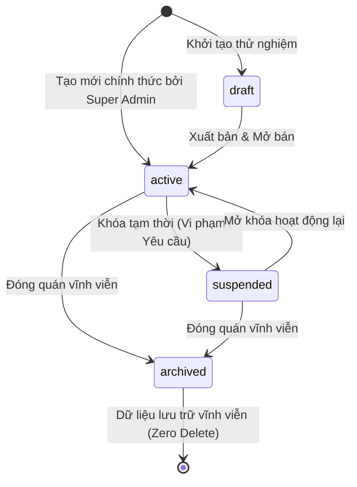

# Chính Sách Vòng Đời Nhà Hàng & Bảo Toàn Dữ Liệu (Lifecycle & Ledger Policy)

Tài liệu đặc tả các trạng thái vòng đời của Nhà hàng (Tenant Lifecycle), chính sách bảo toàn sổ cái tài chính (Zero Hard-Delete) và các đề xuất phối hợp tích hợp với Core ([Issue #6](https://github.com/dothuongton/order_app/issues/6)).

---

## 1. Các Trạng Thái Vòng Đời Nhà Hàng (Tenant Lifecycle)

Trường `status` trong bảng `tenants` được định nghĩa bởi kiểu enum 4 trạng thái:

### 1.1. Trạng Thái `draft` (Bản Nháp / Đang Thiết Lập)
- **Ý nghĩa**: Quán mới được khởi tạo và đang trong giai đoạn cấu hình thực đơn, bàn ăn, thông tin nhận diện.
- **Tác động**:
  - *Khách hàng*: Quét mã QR sẽ nhận được thông báo "Nhà hàng đang trong quá trình chuẩn bị khai trương, vui lòng quay lại sau". Không thể mở phiên đặt món.
  - *Nhân viên & Chủ quán*: Đăng nhập bình thường vào `/staff` và `/staff/cms` để cập nhật menu, tạo bàn, tùy chỉnh giao diện và chạy thử nghiệm.
  - *Super Admin*: Xem danh sách, cập nhật thông tin và chuyển trạng thái sang `active`.

### 1.2. Trạng Thái `active` (Đang Hoạt Động Bình Thường)
- **Ý nghĩa**: Quán mở cửa đón khách và kinh doanh bình thường.
- **Tác động**:
  - Toàn bộ tính năng quét mã QR, gọi món, in bếp, thanh toán và báo cáo hoạt động đầy đủ.

### 1.3. Trạng Thái `suspended` (Tạm Dừng / Khóa Tạm Thời)
- **Ý nghĩa**: Quán bị Super Admin tạm dừng hoạt động (do tranh chấp, quá hạn thanh toán phí nền tảng hoặc có yêu cầu khẩn cấp).
- **Tác động Nghiệp Vụ Quan Trọng**:
  - *Chặn nhận đơn mới*: Khách quét QR không thể mở phiên mới hoặc gửi đơn gọi món mới (`POST /api/v1/guest/orders` trả về `403 FORBIDDEN` kèm thông báo "Nhà hàng đang tạm dừng nhận đơn").
  - *Bảo vệ phiên đang dở dang (Không gây mắc kẹt bill)*: Các phiên bàn đã mở trước thời điểm khóa **phải được phép tiếp tục phục vụ đến khi hoàn tất thanh toán và đóng phiên**. Nhân viên vẫn có quyền gọi `POST /api/v1/staff/sessions/:id/confirm-payment` để thu tiền của khách đang ngồi tại quán.
  - *Quyền nhân viên*: Nhân viên vẫn đăng nhập được vào hệ thống để kiểm tra lịch sử đơn và đối soát số liệu.
  - *Mở lại*: Super Admin có thể chuyển lại sang `active` bất cứ lúc nào.

### 1.4. Trạng Thái `archived` (Đã Lưu Trữ / Ngừng Hoạt Động Vĩnh Viễn)
- **Ý nghĩa**: Nhà hàng chấm dứt hợp đồng sử dụng nền tảng hoặc ngừng kinh doanh vĩnh viễn.
- **Tác động**:
  - Chặn toàn bộ luồng mở phiên và đặt món từ phía khách hàng.
  - Toàn bộ dữ liệu nhà hàng được đóng băng (Read-Only) để phục vụ thanh tra, kiểm toán tài chính và nghĩa vụ thuế.

---

## 2. Chính Sách Bảo Toàn Sổ Cái & Tuyệt Đối Không Xóa Cứng (Zero Hard-Delete)

> [!CRITICAL]
> **Quy tắc Bất Biến**: Hệ thống tuyệt đối **KHÔNG CUNG CẤP TÍNH NĂNG XÓA CỨNG (HARD-DELETE)** bản ghi trong bảng `tenants`.

### Lý do Kỹ thuật & Tài chính:
1. **Toàn Vẹn Dữ Liệu Tài Chính (Ledger Integrity)**:
   - Bảng `orders`, `sessions`, `order_items`, `manual_settlement_confirmations` và `audit_logs` đều liên kết khóa ngoại với `tenants(id)`.
   - Nếu thực hiện lệnh `DELETE FROM tenants WHERE id = ...`, hoặc cơ sở dữ liệu có ràng buộc `ON DELETE CASCADE`, toàn bộ lịch sử hóa đơn, chi tiết món ăn và doanh thu thực tế đã ghi nhận của nhà hàng sẽ bị xóa sạch khỏi cơ sở dữ liệu.
   - Điều này vi phạm nghiêm trọng tính toàn vẹn của hệ thống kế toán và đối soát thanh toán.
2. **Quy Trình Chấm Dứt Hoạt Động**:
   - Khi Super Admin muốn "xóa" một quán trên giao diện, hành động này được thực thi bằng cách cập nhật `status = 'archived'`.
   - Các quán ở trạng thái `archived` sẽ được ẩn khỏi danh sách mặc định (chỉ hiển thị khi Super Admin chủ động chọn bộ lọc "Đã lưu trữ").

---

## 3. Đề Xuất Tích Hợp Gửi Cho Core ([Issue #6](https://github.com/dothuongton/order_app/issues/6))

Để đảm bảo phân hệ Super Admin của `@SangVuxx` và phân hệ Core của `@dothuongton` vận hành đồng bộ và nhất quán, nhóm Super Admin đề xuất các nguyên tắc kỹ thuật sau cho Core:

### Đề xuất 1: Hoàn thiện Middleware `checkTenantStatus` tại Core
- **Vị trí**: `backend/src/middleware/auth.ts`
- **Logic mong muốn**:
  - Phân biệt giữa hành động **Tạo Mới** (mở phiên, thêm món) và hành động **Hoàn Tất Thanh Toán** (thu tiền, chốt phiên, in hóa đơn).
  - Khi quán `suspended`: Chặn `POST /api/v1/guest/*` tạo order/session mới. Cho phép các route xử lý phiên hiện hữu của Staff để tránh kẹt tiền của khách và quán.
  - Khi quán `archived`: Chặn toàn bộ các request ghi mới, chỉ cho phép đọc lịch sử.

### Đề xuất 2: Bổ sung Thông Tin Trạng Thái Tenant vào Token/Context Nhân Viên
- Khi nhân viên đăng nhập qua `/api/v1/staff/auth/login`, bổ sung `tenantStatus: 'active' | 'suspended' | 'archived'` vào payload phản hồi để giao diện Staff có thể hiển thị cảnh báo phù hợp cho nhân viên.

### Đề xuất 3: An Toàn Khóa Ngoại tại Migration Database
- Đối soát lại các ràng buộc Foreign Key liên quan đến `tenant_id` trong toàn bộ cơ sở dữ liệu (liên quan trực tiếp tới [Issue #7 [P1][DATA-01]](https://github.com/dothuongton/order_app/issues/7)), đảm bảo không có cấu hình `ON DELETE CASCADE` nguy hiểm làm mất hóa đơn và biên nhận doanh thu.
