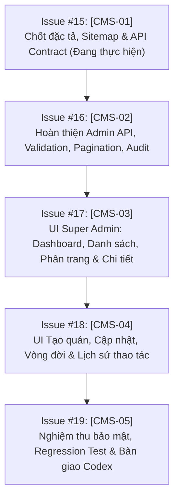

# Kế Hoạch Triển Khai & Bảng Kiểm Nghiệm Thu (Roadmap & Implementation Plan)

Tài liệu xác lập ranh giới tệp (Allowlist), kế hoạch chi tiết cho từng Issue tiếp theo ([#16](https://github.com/dothuongton/order_app/issues/16) $\rightarrow$ [#19](https://github.com/dothuongton/order_app/issues/19)), checklist kiểm thử và tiêu chuẩn bàn giao Codex Review.

---

## 1. Ranh Giới Tệp Được Phép Sửa (Allowlist theo Issue #2)

| Khu Vực | Danh Mục Tệp Được Phép Sửa (@SangVuxx) | Ghi Chú An Toàn |
| :--- | :--- | :--- |
| **Backend** | `backend/src/modules/admin/**` `backend/src/tests/admin-cms/**` | Chỉ phát triển logic Super Admin; gọi shared DB pool/utils đã có; không copy auth thứ hai. |
| **Frontend** | `frontend/src/pages/admin/**` (TRỪ `AdminLogin.tsx`) `frontend/src/components/admin/**` *(tệp mới)* `frontend/src/hooks/admin/**` *(tệp mới)* `frontend/src/api/admin.ts` *(tệp mới)* `frontend/src/types/admin.ts` *(tệp mới)* | `AdminLogin.tsx` do chủ dự án (@dothuongton) sở hữu. Không sửa `App.tsx` hoặc styles toàn cục. |
| **Tests** | `frontend/src/pages/admin/__tests__/**` *(tệp mới)* `frontend/e2e/admin-cms/**` *(tệp mới)* | Chỉ viết test trong namespace riêng được cấp. Không sửa test core để làm xanh suite. |
| **Tài Liệu** | `docs/admin-cms/**` | Nơi lưu trữ đặc tả, hợp đồng và đề xuất tích hợp. |

> [!WARNING]
> **Vùng Cấm (Read-Only)**:
> Tuyệt đối không tự ý chỉnh sửa: `backend/src/modules/cms/**`, `frontend/src/pages/staff/**`, `frontend/src/types/cms.ts`, `backend/src/db/**` (schema/migrations/seed), `backend/src/middleware/auth.ts`, `AdminLogin.tsx`, `App.tsx`.
> Mọi nhu cầu thay đổi dùng chung phải được ghi vào đề xuất trong tài liệu này và gửi qua [Issue #6](https://github.com/dothuongton/order_app/issues/6).

---

## 2. Kế Hoạch Triển Khai Chi Tiết Từng Issue

### 2.1. Issue #15: [CMS-01] Chốt Đặc Tả, Sitemap và API Contract (Pha Hiện Tại)
- **Mục tiêu**: Hoàn tất toàn bộ bộ tài liệu đặc tả chuẩn mực, không sửa code runtime.
- **Sản phẩm bàn giao**:
  - `docs/admin-cms/README.md`: Tổng quan kiến trúc và ranh giới.
  - `docs/admin-cms/SITEMAP_AND_SPEC.md`: Cấu trúc sitemap, luồng UI và ma trận phân quyền RBAC.
  - `docs/admin-cms/API_CONTRACT.md`: Toàn bộ DTO, validation, phân trang, danh mục mã lỗi.
  - `docs/admin-cms/LIFECYCLE_AND_POLICIES.md`: Vòng đời quán, chính sách Zero Hard-Delete, đề xuất cho Core.
  - `docs/admin-cms/ROADMAP_AND_IMPLEMENTATION.md`: Kế hoạch và bảng kiểm.

### 2.2. Issue #16: [CMS-02] Hoàn Thiện Admin API Quản Lý Quán
- **Phạm vi sửa**: `backend/src/modules/admin/**`, `backend/src/tests/admin-cms/**`.
- **Nội dung công việc**:
  1. Refactor `admin.service.ts`:
     - Khắc phục lỗi JOIN trùng lặp khi một quán có nhiều chủ quán (nhóm hoặc lấy chủ quán đầu tiên đại diện).
     - Bổ sung phân trang cho `listShops`: tính `total`, `totalPages`, phân trang `LIMIT $x OFFSET $y`, sắp xếp ổn định `ORDER BY t.created_at DESC, t.id DESC`.
     - Bổ sung phân trang cho `listAuditLogs` và hỗ trợ lọc theo `tenantId`.
     - Thêm phương thức `getShopDetail(id)` trả về đầy đủ metadata + owner + metrics.
  2. Refactor `admin.routes.ts`:
     - Áp dụng Zod schema validation nghiêm ngặt với `.strict()` cho toàn bộ route.
     - Chuẩn hóa mã lỗi trả về (400, 401, 403, 404, 409, 500) theo đúng [API_CONTRACT.md](./API_CONTRACT.md).
  3. Xây dựng test suite `backend/src/tests/admin-cms/admin.api.test.ts`:
     - Test xác thực Super Admin (chặn token thiếu/sai/không phải platform admin).
     - Test phân trang, tìm kiếm, lọc theo trạng thái.
     - Test giao dịch tạo quán mới (rollback sạch khi trùng slug).
     - Test chuyển đổi trạng thái và ghi nhận audit log.

### 2.3. Issue #17: [CMS-03] UI Super Admin: Dashboard, Danh Sách & Chi Tiết
- **Phạm vi sửa**: `frontend/src/api/admin.ts`, `frontend/src/types/admin.ts`, `frontend/src/components/admin/**`, `frontend/src/pages/admin/AdminDashboard.tsx`.
- **Nội dung công việc**:
  1. Tạo file types `frontend/src/types/admin.ts` chuẩn hóa các interface cho Super Admin.
  2. Tạo client API chuyên biệt `frontend/src/api/admin.ts` với đầy đủ typing.
  3. Tách nhỏ `AdminDashboard.tsx` thành các thành phần con có trách nhiệm đơn nhất:
     - `DashboardStatsCards.tsx`: Hiển thị chỉ số nền tảng.
     - `ShopListTable.tsx`: Danh sách quán kèm phân trang, tìm kiếm, lọc trạng thái.
     - `ShopDetailModal.tsx`: Hiển thị chi tiết quán và thông số hoạt động.
  4. Triển khai đầy đủ các trạng thái giao diện: Loading skeleton, Empty state, Error banner kèm nút Thử lại.

### 2.4. Issue #18: [CMS-04] UI Tạo/Cập Nhật Quán, Vòng Đời & Lịch Sử Thao Tác
- **Phạm vi sửa**: `frontend/src/components/admin/**`, `frontend/src/pages/admin/**`.
- **Nội dung công việc**:
  1. Xây dựng `CreateShopModal.tsx`:
     - Tự động sinh slug tiếng Việt không dấu.
     - Inline validation thông báo lỗi từng trường.
     - Chống bấm submit liên tiếp (disable button + spinner).
     - Xóa mật khẩu khỏi state ngay khi đóng hoặc tạo xong.
  2. Xây dựng `EditShopModal.tsx`:
     - Cập nhật tên, slug, phone, address, description.
  3. Xây dựng `LifecycleConfirmModal.tsx`:
     - Thay thế hoàn toàn `window.confirm`.
     - Hiển thị rõ tên quán, trạng thái trước/sau và cảnh báo ảnh hưởng thực tế.
  4. Hoàn thiện tab Nhật Ký Kiểm Toán (Audit Logs) có phân trang và xem chi tiết JSON trước/sau.

### 2.5. Issue #19: [CMS-05] Nghiệm Thu Bảo Mật, Regression Test & Bàn Giao Codex
- **Phạm vi sửa**: `backend/src/tests/admin-cms/**`, `frontend/src/pages/admin/__tests__/**`.
- **Nội dung công việc**:
  1. Chạy toàn bộ backend test suite (bảo đảm 81/81 test core hiện có giữ nguyên kết quả đỗ 100%, cộng thêm các test mới của CMS).
  2. Chạy frontend build (`npm run build`) đảm bảo 0 lỗi TypeScript và 0 cảnh báo lint nghiêm trọng.
  3. Quét diff: Đảm bảo không có `console.log`, `debugger`, `alert` debug, không có secret hoặc PII trong diff.
  4. Kiểm tra diff so với merge-base `1a773f7` chỉ nằm hoàn toàn trong allowlist của `@SangVuxx`.
  5. Soạn Pull Request liên kết Issue #15 $\rightarrow$ #19 kèm báo cáo chi tiết cho `@dothuongton` thực hiện Codex Review.

---

## 3. Bảng Kiểm Tra Nguyên Tắc Karpathy & Clean Code (Pre-PR Checklist)

- [ ] **Giả định rõ ràng (Think Before Coding)**: Mọi quyết định về DTO, URL, trạng thái đều có văn bản đặc tả tham chiếu.
- [ ] **Đơn giản tối đa (Simplicity First)**: Không cài đặt thêm package không cần thiết; tái sử dụng các component và helper hiện hữu.
- [ ] **Can thiệp chuẩn xác (Surgical Changes)**: Không sửa một dòng nào ngoài phạm vi allowlist. Không format lại cả tệp nếu chỉ sửa vài hàm.
- [ ] **Bảo mật nghiêm ngặt**:
  - Không hardcode mật khẩu, token, secret trong mã nguồn.
  - Kiểm tra quyền Super Admin ở server, không chỉ tin tưởng client.
  - Sử dụng parameterized query 100% trong câu lệnh SQL.
- [ ] **Bảo toàn dữ liệu**: Không có câu lệnh `DELETE` nhà hàng; tuân thủ chính sách Zero Hard-Delete.
- [ ] **Kiểm thử tự động thực tế**: Tất cả các test đều chạy thật trên môi trường máy chủ và cơ sở dữ liệu kiểm thử, có log chứng minh.
